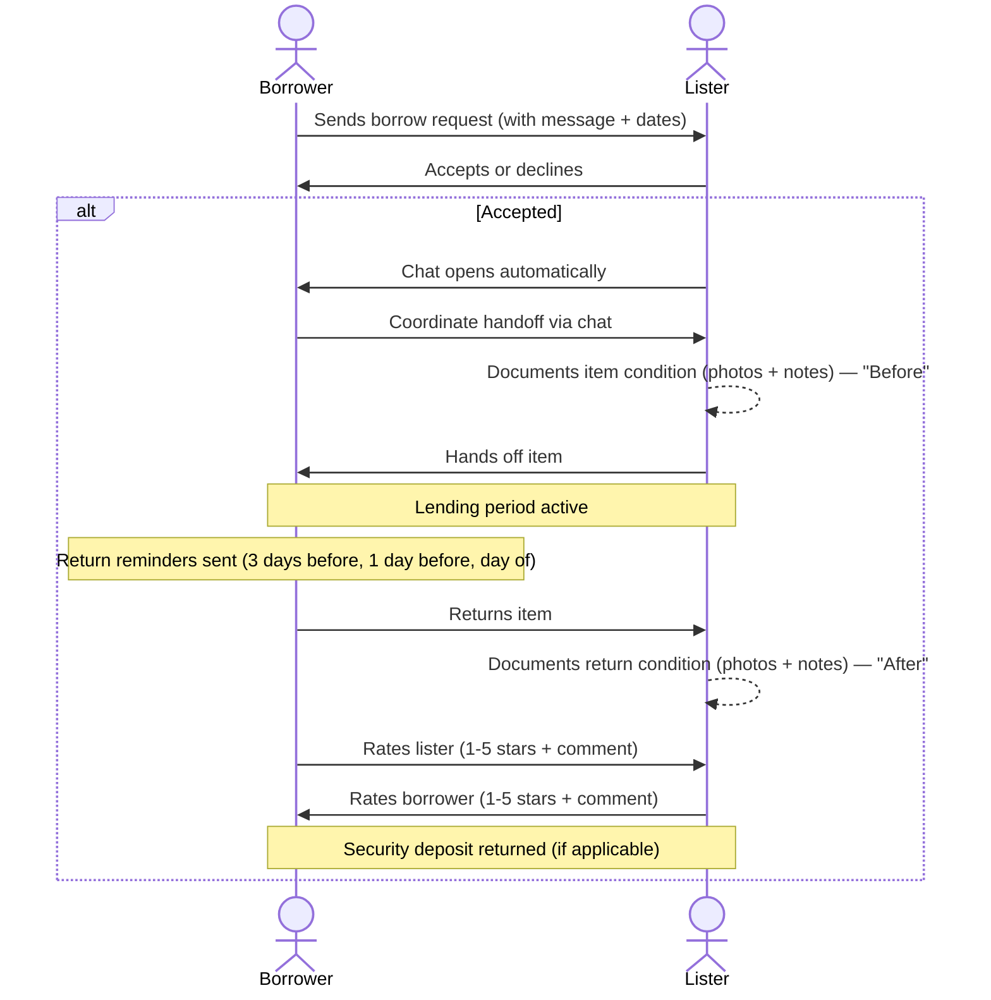

# Demandbase — Product Specification

> **Version**: 1.0  
> **Last Updated**: 2026-11-19  
> **Context**: On-campus hackathon project — live demo required, no scaling concerns

---

## 1. Vision & Elevator Pitch

**Demandbase** is an AI-powered campus resource-sharing platform where anyone can list physical items they own — at any price or for free — for others to borrow for a set duration. It combines the familiarity of OLX with community-driven lending, real-time chat, reputation scoring, and intelligent AI search.

**One-liner**: *"List what you don't use. Borrow what you need. Build community."*

---

## 2. User Roles

| Role | Description |
|---|---|
| **Lister (Seller/Lender)** | Lists items, sets price/free, sets duration, manages requests |
| **Borrower (Buyer)** | Browses, searches, requests items, picks up, returns |
| **Admin** | Exists in the system but has no special powers (placeholder for future) |

> A single user can be both a lister and a borrower simultaneously.

---

## 3. Core Features

### 3.1 Authentication
- **Email + password** registration and login
- No OTP, no social login, no identity verification
- Users create a profile with: name, email, avatar (optional), bio, location/address
- Location captured via browser geolocation or manual address entry

### 3.2 Item Listings

Inspired by OLX's listing flow but tailored for lending/borrowing.

#### Creating a Listing
A lister provides:

| Field | Type | Required | Notes |
|---|---|---|---|
| Title | text | ✅ | Item name |
| Description | text | ✅ | Details, usage instructions |
| Photos | images (up to 5) | ✅ | At least 1 photo required |
| Category | select | ✅ | Electronics, Tools, Sports, Kitchen, Books, Furniture, Other |
| Condition | select | ✅ | New / Like New / Good / Fair / Poor |
| Price | number | ✅ | 0 = free; otherwise per-day rate in ₹ |
| Security Deposit | number | ❌ | Optional refundable deposit amount (₹) |
| Lending Duration | date range | ✅ | Available from → to |
| Payment Method | select | ✅ | UPI / Cash |
| Handoff Method | select | ✅ | Meet in the middle / Third-party delivery (Porter etc.) / Specific location |
| Handoff Details | text | conditional | Address or notes if "specific location" chosen |
| Location | geolocation | ✅ | Auto-detected or manual |

#### AI-Assisted Listing (Gemini)
- **Photo → Auto-fill**: User uploads a photo; Gemini Vision identifies the item, suggests title, description, category, and condition
- **Description Enhancement**: User writes a rough description; Gemini polishes it
- Lister can accept, edit, or discard AI suggestions

#### Listing States
```
Available → Reserved → Lent Out → Returned → Closed
                ↘ Cancelled (by either party before handoff)
```

### 3.3 Browsing & Search

#### Standard Filters
- Category, price range (including "Free only"), condition
- Distance radius (1km, 5km, 10km, 25km)
- Availability dates
- Group-only vs. public

#### AI-Powered Search (Gemini)
The primary search bar is AI-driven:
- User types natural language: *"something to make smoothies"* → finds blenders, mixers, juicers
- *"I need to fix a shelf"* → finds drills, screwdrivers, brackets, spirit levels
- *"party supplies for 20 people"* → finds speakers, plates, decorations, tables
- Gemini understands intent and maps to available listings by analyzing titles + descriptions
- Falls back to keyword search if AI is unavailable

#### Proximity Search
- Results sorted by distance from user's location
- Map view showing nearby listings as pins (Leaflet + OpenStreetMap)
- List view with distance badges ("0.3 km away", "1.2 km away")

### 3.4 Borrowing Flow



### 3.5 Condition Documentation
- **Before handoff**: Lister takes photos of the item and writes condition notes
- **After return**: Lister documents the returned condition
- Both sets of photos are timestamped and stored with the transaction
- Visible to both parties for dispute reference
- **AI Condition Analysis**: Gemini can compare before/after photos and flag visible damage

### 3.6 Security Deposit (Escrow — Simulated)
- Lister sets an optional deposit amount when creating a listing
- When a request is accepted, deposit status is tracked:
  - `pending` → `held` (borrower confirms payment) → `returned` (item returned OK) or `claimed` (damage)
- **No real payment processing** — this is status tracking only
- Both parties see the deposit status in the transaction view

### 3.7 Real-Time Chat
- Chat opens automatically when a request is accepted
- 1:1 between lister and borrower
- Supports text messages
- Real-time via Firestore `onSnapshot` listeners
- Chat is linked to a specific listing/request
- Chat list shows all active conversations with last message preview
- **AI Chatbot** (optional floating widget): answers platform questions, helps navigate

### 3.8 Reputation & Reviews

#### Rating System
- After a completed transaction, **both parties** rate each other
- Rating: 1-5 stars + optional text comment
- Each user can only review the other once per transaction

#### Profile Display
- Average rating (e.g., 4.3 ★)
- Total number of reviews
- Recent reviews (most recent first)
- Stats: items listed, items lent, items borrowed, total transactions

### 3.9 User Profile
Displays:
- Name, avatar, bio, member since date
- Location (city/area, not exact address)
- **Stats grid**: Items Listed | Items Lent | Items Borrowed | Total Transactions
- **Average rating** with star display
- **Review list**: All reviews received, sorted by recency
- Active listings by this user
- If viewing own profile: edit button, my requests, my listings management

### 3.10 Public Demand Calendar

A shared, public calendar where **borrowers post what they need and when**.

#### How It Works
- Any user can create a "demand entry":
  - What they need (title + description)
  - Category
  - When they need it (date range)
  - Budget preference (free only / up to ₹X / any)
- Entries show on a calendar view (month/week)
- **Sellers browse the calendar** to find potential borrowers for their items
- When a lister sees a matching demand, they can respond directly (opens chat)
- Entries auto-expire after the needed date passes
- Status: `Open` → `Fulfilled` → `Expired`

#### AI Enhancement
- Gemini matches new listings against open calendar demands and notifies both parties:
  *"Someone just listed a pressure washer — you posted that you needed one on Nov 25!"*

### 3.11 Private Groups (Communities)
- Users can create private groups for their building, hostel, or community
- Group has: name, description, join code (simple 6-char alphanumeric)
- Members join via the code
- Listings can be marked as "Group only" → visible only to group members
- Group page shows:
  - Member list
  - Group-only listings
  - Group chat (future scope)
- Admin role exists per group (the creator) but has no special moderation powers

### 3.12 Return Reminders
- Automated reminders for active borrows:
  - **3 days before** return date
  - **1 day before** return date
  - **On the return date**
  - **1 day overdue** (if not returned)
- Shown as in-app notifications
- Visible in the borrower's dashboard

### 3.13 Logistics & Handoff (Metadata Only)
When creating a listing, the lister selects:

| Option | Description |
|---|---|
| **Meet in the middle** | Both parties agree on a midpoint location via chat |
| **Third-party delivery** | Lister will send via Porter/Dunzo/etc. (cost discussed in chat) |
| **Specific location** | Lister specifies an address for pickup |

And payment method:

| Option | Description |
|---|---|
| **UPI** | Lister provides UPI ID in chat (if priced item) |
| **Cash** | Payment at handoff |

> These are **informational only** — no in-app payment processing.

---

## 4. AI Features (Gemini API)

| Feature | Trigger | What Gemini Does |
|---|---|---|
| **AI Search** | User types in search bar | Interprets natural language query, matches against listing titles/descriptions, returns ranked results |
| **Photo → Auto-fill** | User uploads photo in listing form | Identifies item, suggests title, description, category, condition |
| **Description Enhancement** | User clicks "Enhance" on their description | Rewrites/polishes the description |
| **Demand-Supply Matching** | New listing created OR new calendar entry created | Checks for matches between listings and calendar demands, suggests connections |
| **Condition Comparison** | After return, both photo sets exist | Compares before/after photos, flags visible differences |
| **AI Chatbot** | User clicks help/chatbot widget | Answers questions about how the platform works, guides through flows |
| **Smart Categorization** | Listing creation | Auto-suggests category and tags from title/description |

---

## 5. Pages & Navigation

```
/                        → Landing page (hero + featured listings + CTA)
/auth/login              → Login form
/auth/register           → Registration form
/dashboard               → User's hub (my listings, my borrows, reminders, stats)
/listings                → Browse all listings (search + filters + map)
/listings/new            → Create a new listing
/listings/[id]           → Listing detail page
/profile                 → Own profile (edit, stats, reviews)
/profile/[id]            → Other user's public profile
/chat                    → All conversations
/chat/[id]               → Chat thread
/calendar                → Public demand calendar
/groups                  → My groups list
/groups/new              → Create a group
/groups/[id]             → Group detail (members + group listings)
/groups/join             → Join a group via code
```

---

## 6. Non-Functional Requirements

| Aspect | Requirement |
|---|---|
| **Performance** | Fast enough for a live demo — no optimization needed |
| **Scalability** | Not required — hackathon scope |
| **Security** | API keys server-side, Firebase security rules basic, no hardened auth |
| **Browser Support** | Latest Chrome (demo machine) |
| **Responsive** | Desktop-first, basic mobile responsiveness |
| **Accessibility** | Basic (semantic HTML, contrast) — not a priority |

---

## 7. Out of Scope (For Now)

- Skill sharing, space sharing, time banking
- Real payment processing (UPI/Stripe/etc.)
- OTP or identity verification
- Admin moderation tools
- Leaderboards
- Push notifications (web or mobile)
- Native mobile app
- Email notifications
- Advanced dispute resolution
- Analytics dashboard
